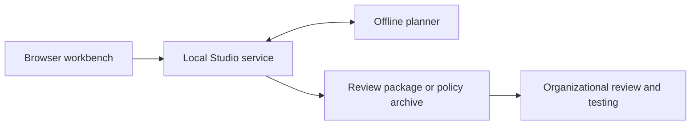

# Relution Policy Studio

Relution Policy Studio brings institutional planning, policy editing and
evidence review into one local application. Use the browser workbench to build
a plan, review policy changes and export artifacts for further review. The
interface connects to an authenticated local service and an offline planner;
Relution operations remain read-only.

> _Claude was used to polish and proof-read the code and documentation of this repository._

<details>
<summary>Status and limitations</summary>

**Project status:** Relution Policy Studio is an independent experimental project for
institutional planning, policy engineering and evidence review. Developed independently
alongside my main professional work. The alpha is a starting point for evaluation and
adaptation, not a ready-to-use administration product. Relution operations remain read-only,
and generated MDM artifacts remain LAB-only.

**Disclaimer.** Local validation, recommendations and review packages are not legal advice,
a compliance determination or deployment approval. Review policies, evidence, permissions
and device effects independently; any real deployment requires the responsible
organization's own authorization and testing.

</details>

The browser, local service and offline planner work together without granting
deployment authority:



From this directory:

```sh
pnpm bootstrap
pnpm studio
```

Use Node.js 22.12 or newer, Python 3.11 or newer, pnpm 10.34.5 and uv 0.10.7 or newer. Recent Node.js releases no longer bundle corepack; without a pnpm installation, run each command as `npx -y pnpm@10.34.5 …` (for example `npx -y pnpm@10.34.5 bootstrap`). One pnpm workspace with a single lockfile covers the JavaScript applications; the planner and the policy engine's data tooling keep separate locked uv environments. The launcher builds the workbench, starts one loopback host and opens its capability URL in the browser. `pnpm studio --help` describes port, data-directory and headless options.

Create a blank project or adapt the supplied institution reference. Edit organizations, locations, cohorts, intent and blueprints. In Policies, create a policy workspace, author configurations and review explicit intent-to-field mappings. Save and validate policy changes before building an archive. Attach evidence-file and artifact hashes, then export a review package retaining unresolved requirements. Planning drafts autosave; concrete policy edits require Save changes.

Archives, Device assessment and Settings remain directly accessible. Native and Apple configurations, sidecar artifacts, baseline construction, recommendations, compliance and archive import/export use the retained engine behavior. Relution operations remain read-only. Zammad ticket creation requires an explicit reviewed ticket action. MDM generation remains LAB-only. Local validation and review never grant deployment authority.

Projects live under `~/.local/share/campusweave` by default, outside the repository. The launcher opens the studio through `open-studio.html`, a private file in the data directory that also reopens a closed tab; `--no-open` prints the capability URL instead. Keep that file, any printed URL and this private directory local. A revision conflict stops autosave and keeps unsaved changes in the tab; export a recovery copy or download the latest saved version to compare, then discard your changes or keep them on top of the latest version, and restore an exported copy from Project tools. Projects, workspace-plus-sidecar transactions and archive publication are separate persistence boundaries. Multi-workspace results report partial outcomes explicitly.

Compatibility entry points remain available (`pnpm campusweave` remains an alias for `pnpm studio`):

```sh
pnpm planner --help
pnpm planner serve  # Original planner browser at 127.0.0.1:8766
pnpm rexp --help
```

These run the imported applications from their own directories. Existing v1 planner schemas and CLI behavior, `.rexp` archives, workspace/sidecar formats and original histories are retained. The v2 conversion keeps unrepresentable legacy dimensions and ownership ambiguities as unresolved records.

Repository layout:

| Path | Purpose |
| --- | --- |
| `apps/workbench` | The studio's React interface |
| `apps/policy-engine` | Policy domain, `rexp` CLI, the authenticated loopback host and project store, legacy editor UI and offline data tooling |
| `apps/planner` | Offline Python planner: profile compilation, stdio bridge, v1 CLI and legacy planner browser |
| `contracts` | Cross-language JSON schemas and golden fixtures |
| `tools` | Launcher, task runner and boundary check |

Applications depend on each other only through declared package entry points (`rexp-studio/host`, `rexp-studio/browser`, `rexp-studio/ui`, and `rexp-studio/testing` for integration tests) and the planner's stdio protocol; `pnpm verify` enforces these import rules.

Verification:

```sh
pnpm verify
```

`pnpm verify` runs the boundary, formatting, lint, type, hygiene and build gates; it is also what public CI runs. General CI starts automatically only for Dependabot-authored pull requests and can be dispatched manually. CodeQL and Scorecard retain their security-only push/scheduled triggers. No automatic deployment or release workflow is configured. The regression test suites are maintained privately and are not part of the public tree.

New to the code? Start with [How Relution Policy Studio works](docs/ARCHITECTURE.md): runtime, user journeys, data directory and code map. See the [architecture decision](docs/architecture/0001-unified-product.md) and the [approved design manifest](docs/design/manifest.json). Local macOS results, prepared Ubuntu CI, browser checks and live-service/device verification are reported separately.

The original CampusWeave and REXP Studio repositories remain untouched in their original locations. Repository-authored source code is licensed under the [MIT License](LICENSE). Third-party reference data and material derived from it keep their own upstream terms; see [NOTICE](NOTICE).

See the [product naming migration](docs/migration/PRODUCT-NAMING.md) for preserved technical identities.
