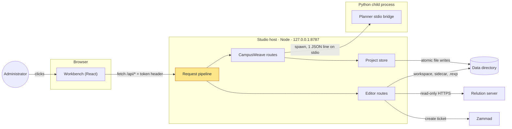
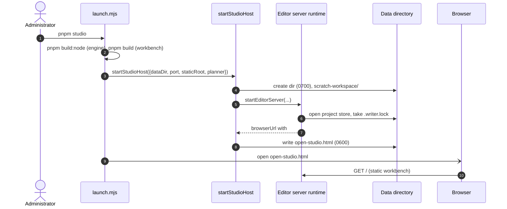
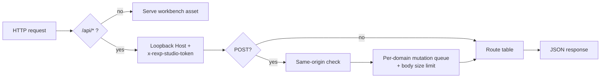
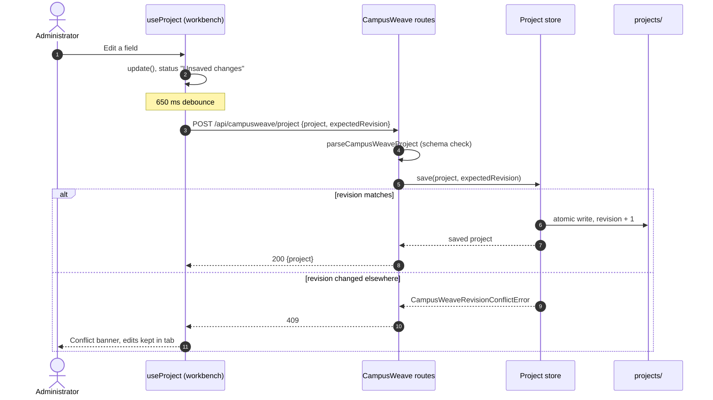
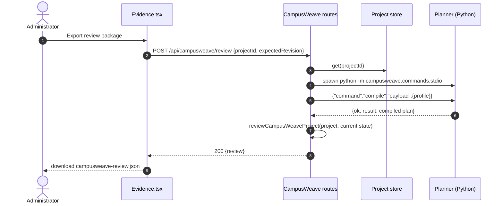
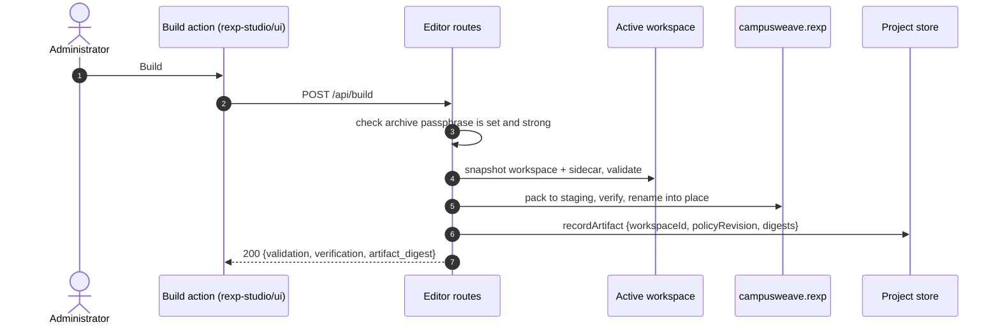
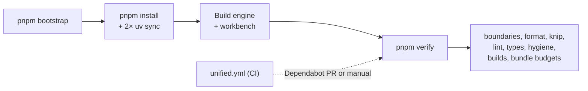

# How Relution Policy Studio works

A newcomer's map of the running system: what starts what, where each user
action lands in the code, where state lives and how the repository is checked.
The design decisions behind this shape are recorded in
[architecture/0001-unified-product.md](architecture/0001-unified-product.md);
this page describes the code as it runs.

## In one paragraph

`pnpm studio` builds two front-end bundles and starts one Node process, the
**Studio host**, bound to `127.0.0.1`. The host serves the React **workbench**
to the browser, answers its token-authenticated `/api/*` calls and keeps all
state in a private data directory (`~/.local/share/campusweave` by default).
Planning logic lives in a separate Python **planner** that the host spawns per
request and talks to over one JSON line on stdio; there is no second server.
The only outbound network calls go to Relution (read-only) and Zammad (ticket
creation after an explicit reviewed action).

## System overview

What runs where, and how the pieces talk:

The host is one HTTP server with two families of routes. **CampusWeave
routes** own projects (institution profile, intent, mappings, evidence) and
are the only callers of the planner. **Editor routes** are the retained REXP
Studio policy editor: workspaces, Apple/native configurations, archive build
and import, compliance, and the Relution and Zammad integrations. The browser
never talks to the planner, the data directory or external services directly.

Where in the code:

- [tools/runtime/launch.mjs](../tools/runtime/launch.mjs): `pnpm studio`
- [apps/policy-engine/src/host/index.ts](../apps/policy-engine/src/host/index.ts): `startStudioHost`, the composition root
- [apps/policy-engine/src/editor/editor-server-runtime.ts](../apps/policy-engine/src/editor/editor-server-runtime.ts): opens the project store, creates the HTTP server
- [apps/policy-engine/src/editor/editor-server-routes.ts](../apps/policy-engine/src/editor/editor-server-routes.ts): `EDITOR_API_HANDLERS`, the ordered route table
- [apps/policy-engine/src/integrations/campusweave/planner-worker.ts](../apps/policy-engine/src/integrations/campusweave/planner-worker.ts): spawns the planner
- [apps/planner/campusweave/commands/stdio.py](../apps/planner/campusweave/commands/stdio.py): the planner side of the bridge

## How it runs

What happens between `pnpm studio` and a usable browser tab:

Steps 4–5 refuse a data directory that is, or sits under, a symlink, and
require the planner's `.venv` to exist (`pnpm bootstrap` creates it). Step 6
takes a single-writer lock so two hosts cannot share one project root. The
capability token is generated per run and only travels in the URL fragment of
the private launch file (steps 7–9), so it never appears in `argv` or terminal
output unless `--no-open` asks for it. Ctrl-C, `SIGTERM` and `SIGHUP` remove
the launch file and release the lock.

**Every API request** passes the same pipeline before reaching a handler:

Mutations are classified by path into a domain (`workspace`, `campusweave`,
`relution`, `zammad`), each with its own body limit and a serial queue, so two
writes to the same domain never interleave. Workspace requests also carry
`x-rexp-studio-workspace`; if another tab switched the active workspace in
the meantime, the host answers 409 instead of acting on the wrong one.

Where in the code:

- [apps/policy-engine/src/editor/editor-server-request.ts](../apps/policy-engine/src/editor/editor-server-request.ts): `handleEditorHttpRequest`, the pipeline
- [apps/policy-engine/src/editor/editor-api-request-guards.ts](../apps/policy-engine/src/editor/editor-api-request-guards.ts) and [editor-http-authority.ts](../apps/policy-engine/src/editor/editor-http-authority.ts): token, Host and Origin checks
- [apps/policy-engine/src/editor/editor-request-dispatcher.ts](../apps/policy-engine/src/editor/editor-request-dispatcher.ts): `classifyEditorPostRoute`, domains and body limits
- [apps/policy-engine/web/src/shared/editor-api-client.ts](../apps/policy-engine/web/src/shared/editor-api-client.ts): `editorApiFetch`, the browser side (token and workspace headers)

### Other entry points

The same engine and planner also run without the workbench. These are
compatibility paths and share no runtime with `pnpm studio`:

| Command | What starts |
| --- | --- |
| `pnpm rexp …` | The `rexp` CLI ([apps/policy-engine/src/cli.ts](../apps/policy-engine/src/cli.ts)); `rexp serve` starts the legacy editor UI |
| `pnpm planner …` | The v1 planner CLI; `pnpm planner serve` starts the legacy planner browser on `127.0.0.1:8766` ([apps/planner/campusweave/server.py](../apps/planner/campusweave/server.py)) |

## User journeys

### Editing the institution plan (autosave)

Which parts are reached when the user edits anything under Overview,
Institution or Intent:

Drafts may be incomplete; the save only checks shape and size (4 MiB), not
planning correctness. The optimistic revision (step 4) is the only
concurrency control between tabs: on a 409 autosave stops and the user
chooses between their tab and the latest saved version. Policy edits in the
Policies screen do **not** autosave; they go through the editor routes and an
explicit Save.

Where in the code:

- [apps/workbench/src/useProject.ts](../apps/workbench/src/useProject.ts): `update`, `flush`, conflict state
- [apps/workbench/src/api.ts](../apps/workbench/src/api.ts): `request`, `planner`
- [apps/policy-engine/src/editor/campusweave/routes.ts](../apps/policy-engine/src/editor/campusweave/routes.ts): `saveProject`
- [apps/policy-engine/src/workspace-state/campusweave-project-store.ts](../apps/policy-engine/src/workspace-state/campusweave-project-store.ts): `saveProject`

### Reviewing and exporting a project

What happens when the user opens Review or clicks "Export review package":

The host never trusts a compilation sent by the browser; it recompiles the
saved profile itself (steps 4–6). Each planner call is a fresh process with a
1 MiB request cap, a 4 MiB response cap and a 30 s timeout. If the planner
fails, the review still returns, with `plannerFailure` set, so the user sees
what is missing instead of an empty page. Step 7 compares the project's
evidence references with the current workspace revision, artifact digest and
catalog digest and marks stale evidence; deployment flags in the result are
always false.

Where in the code:

- [apps/workbench/src/Evidence.tsx](../apps/workbench/src/Evidence.tsx): `exportReview`
- [apps/policy-engine/src/editor/campusweave/routes.ts](../apps/policy-engine/src/editor/campusweave/routes.ts): `reviewProject`
- [apps/policy-engine/src/integrations/campusweave/planner-worker.ts](../apps/policy-engine/src/integrations/campusweave/planner-worker.ts): `runCampusWeavePlanner`
- [apps/planner/campusweave/profiles_v2/](../apps/planner/campusweave/profiles_v2/): `compile_profile`, `validate_profile`, `reference_profile`
- [apps/policy-engine/src/application/campusweave-review.ts](../apps/policy-engine/src/application/campusweave-review.ts): `reviewCampusWeaveProject`

### Building the policy archive

What happens when the user clicks Build in Policies:

The archive is packed into a staging file and re-read and verified before it
replaces the output (step 5), so a failed build never leaves a half-written
`.rexp`. Step 6 is what links the binary artifact back to the planning
project; the review in the previous journey uses that record to decide
whether evidence is current.

Where in the code:

- [apps/policy-engine/web/src/features/artifacts/editor-build-action.ts](../apps/policy-engine/web/src/features/artifacts/editor-build-action.ts): browser side
- [apps/policy-engine/src/editor/editor-server-archive-compliance-routes.ts](../apps/policy-engine/src/editor/editor-server-archive-compliance-routes.ts): `handleArchiveBuildRequest`
- [apps/policy-engine/src/editor/editor-build-publish.ts](../apps/policy-engine/src/editor/editor-build-publish.ts): `buildVerifiedEditorArchive`
- [apps/policy-engine/src/archive/](../apps/policy-engine/src/archive/): `.rexp` packing and inspection

## Data model

Everything persistent lives in the data directory (default
`~/.local/share/campusweave`, override with `--data-dir`). Nothing is written
to the repository.

| Path | Holds | Written by |
| --- | --- | --- |
| `open-studio.html` | Redirect to the capability URL, mode 0600; removed on shutdown | `startStudioHost` |
| `scratch-workspace/` | Policy workspace used before a project workspace is activated | `initializeEmptyEditorWorkspace` |
| `campusweave.rexp` | Last built, verified policy archive | `buildVerifiedEditorArchive` |
| `projects/.writer.lock` | Single-writer lock for the project root | project store |
| `projects/active-workspace.json` | Which project workspace the editor targets after restart | project store |
| `projects/projects/` | One JSON file per project: profile, intent, mappings, workspace refs, evidence index, `revision` | project store |
| `projects/workspaces/<id>/` | Project-owned policy workspaces; `state.json` + `journal.json` publish workspace and sidecar as one unit | [persistence.ts](../apps/policy-engine/src/workspace-state/persistence.ts) |
| `projects/artifacts/` | Per-workspace build record: policy revision and artifact, catalog and assurance digests | `recordArtifact` |

The three write boundaries (project revision, workspace-plus-sidecar
transaction, archive publication) are separate on purpose; there is no
cross-store atomicity, and multi-workspace results report partial success.
The persisted shapes are pinned by JSON schemas in
[contracts/schemas](../contracts/schemas), and
[contracts/fixtures/canonical-json-vectors.json](../contracts/fixtures/canonical-json-vectors.json) pins the canonical-JSON digest that
Python, the engine and the workbench must compute identically.

## Build and verification

How the repository is set up and checked:

`pnpm verify` is the single gate locally and in CI; there is no deploy or
release workflow. CodeQL and Scorecard run separately on push and schedule.
The regression test suites are kept outside the public tree.
`tools/check-boundaries.mjs` and the engine's `check-architecture.mjs` fail
the gate if one app imports another outside its declared entry points
(`rexp-studio/host`, `/browser`, `/ui`, `/testing`) or the planner's stdio
protocol.

Where in the code:

- [tools/runtime/tasks.mjs](../tools/runtime/tasks.mjs): `setup`, `verify`, `planner`, `rexp` tasks
- [tools/check-boundaries.mjs](../tools/check-boundaries.mjs)
- [.github/workflows/unified.yml](../.github/workflows/unified.yml)

## Code map

In the order a newcomer would read it:

| Path | Responsibility |
| --- | --- |
| [tools/runtime/](../tools/runtime/) | `pnpm studio` launcher and the task runner behind every root script |
| [apps/policy-engine/src/host/](../apps/policy-engine/src/host/) | `startStudioHost`: data directory, planner path, launch file |
| [apps/policy-engine/src/editor/](../apps/policy-engine/src/editor/) | HTTP server, request pipeline, all `/api/*` route handlers |
| [apps/policy-engine/src/editor/campusweave/](../apps/policy-engine/src/editor/campusweave/) | Project, planner, review, mapping-projection and workspace routes |
| [apps/policy-engine/src/workspace-state/](../apps/policy-engine/src/workspace-state/) | Project store and the workspace-plus-sidecar transaction |
| [apps/policy-engine/src/application/](../apps/policy-engine/src/application/) | Use cases: review, compliance, Relution assessment, Zammad tickets |
| [apps/policy-engine/src/integrations/](../apps/policy-engine/src/integrations/) | Planner worker, Relution (read-only) and Zammad clients |
| [apps/policy-engine/src/archive/](../apps/policy-engine/src/archive/), [apple/](../apps/policy-engine/src/apple/), [mdm/](../apps/policy-engine/src/mdm/) | Policy domain: `.rexp` format, Apple payloads, LAB-only MDM generation |
| [apps/policy-engine/src/browser/](../apps/policy-engine/src/browser/) | `rexp-studio/browser`: DTOs and canonical JSON shared with the workbench |
| [apps/policy-engine/web/](../apps/policy-engine/web/) | Legacy editor UI; `web/src/studio-ui.ts` is the `rexp-studio/ui` entry the workbench embeds |
| [apps/workbench/src/](../apps/workbench/src/) | React workbench: `App.tsx` (navigation), `useProject.ts` (autosave), one file per screen |
| [apps/planner/campusweave/commands/stdio.py](../apps/planner/campusweave/commands/stdio.py) | Planner bridge: `reference`, `convert-v1`, `validate`, `compile` |
| [apps/planner/campusweave/profiles_v2/](../apps/planner/campusweave/profiles_v2/) | v2 profile validation, compilation and v1 conversion |
| [apps/planner/campusweave/](../apps/planner/campusweave/) (rest) | v1 planner, contracts, OpenAPI catalog, legacy server |
| [contracts/](../contracts/) | Cross-language schemas and golden fixtures |
